<div align="center">



<br/>

<a href="mailto:remontree4711@gmail.com"></a>
<a href="https://babyseal4711.tistory.com"></a>
<a href="https://www.linkedin.com/in/jongwon-lee-a3702a169"></a>
<a href="https://www.instagram.com/jong_1_02/"></a>

</div>

<br/>



```yaml
callsign : remontree
name     : 이종원 (Lee Jong Won)
base     : Kyung Hee Univ. — Computer Engineering × Applied Physics
role     : Propulsion Program PM @ TUSI Rocketry  ·  Founder @ remon(리몬)
orbit    : [ ML for Aerospace, Physics Simulation, RL-based Optimization ]
logbook  :
  - SW Maestro 13th                        # 2022
  - ROKAF IT Development Specialist        # 2024 – 2026, 1y 9m
  - Coding Instructor @ Tedi               # 2 yrs
status   : 🟢 GO FOR LAUNCH
```

> **로켓을 만들고, 그 로켓이 날아가는 세상을 코드로 다시 만듭니다.**
> 엔진을 설계하고, 시뮬레이터를 짜고, 강화학습으로 최적의 형상과 제어 값을 찾아요.
> 하드웨어 · 펌웨어 · 지상국 · 시뮬레이션 · ML을 한 흐름으로 다루는 것을 좋아합니다.

<br/>





<br/>



#### `STAGE 1` — PROPULSION & FLIGHT · TUSI Rocketry

| | Mission | Objective | Window |
|:-:|---|---|:-:|
| 🟠 | **ODYSSEY** | 1kN급 N₂O/HDPE 하이브리드 로켓 엔진 + 통합 테스트베드 + 지상 컨트롤 시스템. 핫파이어 5회, TRL 2 → 4 목표 · **총괄 PM** | `2024–27` |
| 🟠 | **TAS-1** | 하이브리드 로켓 엔진 시뮬레이터 + 강화학습 기반 엔진 형상 최적화기 | `2025–26` |
| 🔵 | **SIERA** | 미션 정의 · ConOps · RTM을 관리하는 시스템 엔지니어링 툴 | `2026` |
| 🔵 | [**RCTS**](https://github.com/remontree/RCTS) | 고체 로켓 비행 시뮬레이터 + 강화학습 카나드 핀 PID 튜너 → 📄 논문 | `2024` |
| 🔵 | [**MFA**](https://github.com/remontree/arduino-avionics-framework) | NURA 2024 로켓 발사 대회용 에비오닉스 펌웨어 · 하드웨어 | `2024` |
| 🔵 | [**MFGCS**](https://github.com/remontree/rocket-ground-control-station) | NURA 2024 로켓 발사 대회용 지상국 | `2024` |
| 🔵 | [**TMS-DAQ**](https://github.com/remontree/Tusi-TMS-DAQ-System) | 로켓 엔진 시험용 데이터 수집 시스템 | — |

#### `STAGE 2` — INTELLIGENCE & PRODUCT

| | Mission | Objective | Window |
|:-:|---|---|:-:|
| 🟠 | **SBook** | 강의 PDF를 넣으면 직접 돌려 보는 3D 장면이 붙은 레슨으로 바꿔 주는 이공계 AI 교과서 · *remon* | `2026–` |
| 🔵 | **ROKAF** | 대한민국 공군 전투기 조종사용 체계 개발 | `2025–26` |
| 🔵 | **nOOnchi** | SW 마에스트로 · 통화 내용을 BERT로 분석하는 보이스피싱 탐지 앱 | `2022` |

#### `STAGE 3` — DEEP SPACE · Science

| | Mission | Objective | Window |
|:-:|---|---|:-:|
| 🔵 | [**stardetector**](https://github.com/remontree/stardetector) | 아두이노 + 웹 기반 GOTO 망원경 경위대와 제어 소프트웨어 | `2023` |
| 🔵 | [**Quself**](https://github.com/remontree/Quself) | NumPy로 만든 15큐빗 양자 회로 시뮬레이터 | `~2022` |

<sub>🟠 ACTIVE &nbsp;·&nbsp; 🔵 COMPLETE</sub>

<br/>



<div align="center">
<br/>

<br/><br/>

<br/><br/>


</div>

<br/>



**📄 Publication**

> **모델 로켓 비행 시뮬레이터 개발 및 강화학습과 지글러-니콜스 방법을 활용한 모델 로켓 카나드 핀의 PID 제어기 최적화**
> <sub>한국추진공학회 2024년도 제63회 추계학술대회 논문집</sub>

**🏆 Awards**

```diff
+ 2024  경희대학교 SW FESTIVAL ·························· 최우수상
  2024  경희대학교 KHUTHON ······························· 우수상 · 인기상
  2023  경희대학교 KHUTHON ······························· 우수상
  2026  경희대학교 SW FESTIVAL ·························· 장려상
  2026  대한민국 공군 창업 경진대회 ······················· 장려상
  2025  대한민국 공군 창의 혁신 AI 해커톤 ················· 장려상
  2023  경희대학교 SW FESTIVAL ·························· 주니어상
  2022  경희대학교 SW FESTIVAL ·························· 주니어상
```

<br/>



<div align="center">
<br/>


<br/>

</div>

<br/>


